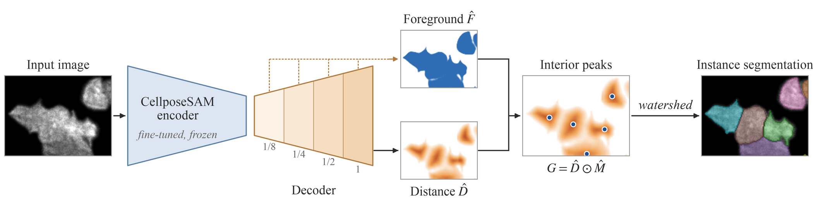

# TouchSplit

<p align="center">
  
</p>

## Overview

We propose TouchSplit, a lightweight decoder that jointly predicts a foreground map and a per-instance normalized distance field that provides interior markers for watershed partitioning. It segments both isolated and touching platelets in live-cell total internal reflection fluorescence (TIRF) microscopy, including contacts with barely visible boundaries, and was also evaluated on four public 2D cell datasets.

For questions or problems, please open an [issue](https://github.com/JINGHANcoco/touchsplit/issues).

## Installation

```bash
git clone https://github.com/JINGHANcoco/touchsplit.git
cd touchsplit
conda create -n touchsplit python=3.11
conda activate touchsplit
pip install -r requirements.txt
```

## Usage

### 1. Configuration
All settings are in `touchsplit.yml`:

* **data**: dataset name and paths (CTC folder, or a CSV with `image_path`, `mask_path`, `set`).
* **encoder / decoder**: training epochs, learning rate, weight decay, batch size and distance-loss weight.
* **decode**: watershed marker parameter for each dataset.

### 2. Training
Fine-tune the CellposeSAM encoder, then train the TouchSplit decoder on the frozen encoder:
```bash
python touchsplit.py train -c touchsplit.yml
```

### 3. Inference
Write 16-bit instance label images for a folder of `.tif` images:
```bash
python touchsplit.py predict -c touchsplit.yml \
    -e weights/cellpose_ft_DIC-C2DH-HeLa_s0.pt \
    -w weights/touchsplit_head_DIC-C2DH-HeLa_s0.pt \
    -i /path/to/input_images \
    -o /path/to/output_results
```

To reproduce the paper experiments, see [REPRODUCE.md](REPRODUCE.md).

## Citation
To Be Determined

## License
MIT (see [LICENSE](LICENSE)).
