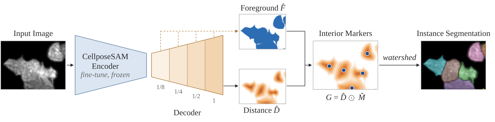

# TouchSplit

<p align="center">
  
</p>

## Overview

We propose TouchSplit, a lightweight decoder that jointly predicts a foreground map and a per-instance normalized distance field that provides interior markers for watershed partitioning. It segments both isolated and touching platelets in live-cell total internal reflection fluorescence (TIRF) microscopy, including contacts with barely visible boundaries, and was also evaluated on four public 2D cell datasets.

For questions or problems, please open an issue.

## Installation

```bash
git clone https://github.com/JINGHANcoco/touchsplit.git
cd touchsplit
conda create -n touchsplit python=3.11
conda activate touchsplit
pip install -r requirements.txt
```

## Usage

### 1. Configuration
All settings are in `touchsplit.yml`:

* **data**: dataset name and paths (CTC folder, or a CSV with `image_path`, `mask_path`, `set`).
* **encoder / decoder**: training epochs, learning rate, weight decay, batch size and distance-loss weight.
* **decode**: watershed marker parameter for each dataset.

### 2. Training
Fine-tune the CellposeSAM encoder, then train the TouchSplit decoder on the frozen encoder:
```bash
python touchsplit.py train -c touchsplit.yml
```

### 3. Inference
Write 16-bit instance label images for a folder of `.tif` images:
```bash
python touchsplit.py predict -c touchsplit.yml \
    -e weights/cellpose_ft_DIC-C2DH-HeLa_s0.pt \
    -w weights/touchsplit_head_DIC-C2DH-HeLa_s0.pt \
    -i /path/to/input_images \
    -o /path/to/output_results
```

To reproduce the paper experiments, see [REPRODUCE.md](REPRODUCE.md).

## Reproducibility details

### Pretrained checkpoints

Checkpoints for all four public datasets are available in this [Google Drive folder](https://drive.google.com/drive/folders/1aSH5HaydQLerZTgEPIcp2-TZBvdRWq6L?usp=sharing).

| Dataset | Fine-tuned CellposeSAM encoder | TouchSplit decoder |
| --- | --- | --- |
| DIC-C2DH-HeLa | Seed 0 | Seeds 0, 1, 2 |
| Fluo-N2DL-HeLa | Seed 0 | Seeds 0, 1, 2 |
| Fluo-C2DL-MSC | Seed 0 | Seeds 0, 1, 2 |
| PhC-C2DH-U373 | Seed 0 | Seeds 0, 1, 2 |

The folder contains 16 checkpoint files: 4 encoders named `cellpose_ft_<dataset>_s0.pt` and 12 decoders named `touchsplit_head_<dataset>_s<seed>.pt`. For each dataset, pair any of its three decoders with its seed-0 encoder.

###  Public datasets

- [DIC-C2DH-HeLa](https://zenodo.org/api/records/15608194/files/DIC-C2DH-HeLa.zip/content) (Zenodo mirror)

- [Fluo-N2DL-HeLa](https://www.kaggle.com/api/v1/datasets/download/xunbch/hela-train) (Kaggle mirror)

- [Fluo-C2DL-MSC](https://data.celltrackingchallenge.net/training-datasets/Fluo-C2DL-MSC.zip)

- [PhC-C2DH-U373](https://zenodo.org/api/records/15608252/files/PhC-C2DH-U373.zip/content) (Zenodo mirror)

### Private datasets

Please contact the author for details.

## Evaluation results

### DIC-C2DH-HeLa

Evaluation uses all 84 frames of sequence 02, with GT annotations for 9 frames and ST annotations for the remaining 75 frames. All three decoders use the same seed-0 encoder and `hmax:0.25` watershed markers. Scores are computed using the evaluation implementation in `utils.py`.

| Decoder seed | SEG | Touch SEG | Nontouch SEG |
| --- | --- | --- | --- |
| 0 | 0.8915 ± 0.0309 | 0.8977 ± 0.0279 | 0.8777 ± 0.0822 |
| 1 | 0.8875 ± 0.0347 | 0.8942 ± 0.0302 | 0.8726 ± 0.0921 |
| 2 | 0.8898 ± 0.0343 | 0.8957 ± 0.0298 | 0.8779 ± 0.0804 |
| **Three-seed summary** | **0.8896 ± 0.0326** | **0.8959 ± 0.0288** | **0.8761 ± 0.0826** |

To reproduce these results, place the checkpoints from the shared folder in `pretrained/` and extract the training dataset to `data/CTC/DIC-C2DH-HeLa/`, preserving its `01`, `02`, GT and ST directories. Run the following commands from the repository root:

```bash
# Predict sequence 02 and evaluate each decoder seed separately.
for SEED in 0 1 2; do
  python touchsplit.py predict -c touchsplit.yml -d DIC-C2DH-HeLa \
    -e pretrained/cellpose_ft_DIC-C2DH-HeLa_s0.pt \
    -w "pretrained/touchsplit_head_DIC-C2DH-HeLa_s${SEED}.pt" \
    --decode hmax:0.25 \
    -i data/CTC/DIC-C2DH-HeLa/02 \
    -o "predictions/DIC-C2DH-HeLa_s${SEED}"

  python touchsplit.py evaluate -c touchsplit.yml -d DIC-C2DH-HeLa \
    --ctc-root data/CTC \
    --pred "predictions/DIC-C2DH-HeLa_s${SEED}"
done

# Report the three-seed summary with standard deviations across images.
python touchsplit.py evaluate -c touchsplit.yml -d DIC-C2DH-HeLa \
  --ctc-root data/CTC \
  --pred predictions/DIC-C2DH-HeLa_s0 \
         predictions/DIC-C2DH-HeLa_s1 \
         predictions/DIC-C2DH-HeLa_s2
```

### Fluo-N2DL-HeLa

Evaluation uses all 92 frames of sequence 02, with GT annotations for 8 frames and ST annotations for the remaining 84 frames. All three decoders use the same seed-0 encoder and `hmax:0.2` watershed markers. Scores are computed using the evaluation implementation in `utils.py`.

| Decoder seed | SEG | Touch SEG | Nontouch SEG |
| --- | --- | --- | --- |
| 0 | 0.9327 ± 0.0331 | 0.8906 ± 0.0382 | 0.9414 ± 0.0317 |
| 1 | 0.9337 ± 0.0321 | 0.8949 ± 0.0418 | 0.9413 ± 0.0316 |
| 2 | 0.9323 ± 0.0331 | 0.8929 ± 0.0377 | 0.9401 ± 0.0328 |
| **Three-seed summary** | **0.9329 ± 0.0327** | **0.8928 ± 0.0386** | **0.9409 ± 0.0319** |

To reproduce these results, place the checkpoints in `pretrained/` and extract the training dataset to `data/CTC/Fluo-N2DL-HeLa/`, preserving its image and GT/ST directories. Run the following commands from the repository root:

```bash
DS=Fluo-N2DL-HeLa
for SEED in 0 1 2; do
  python touchsplit.py predict -c touchsplit.yml -d "$DS" \
    -e "pretrained/cellpose_ft_${DS}_s0.pt" \
    -w "pretrained/touchsplit_head_${DS}_s${SEED}.pt" \
    --decode hmax:0.2 \
    -i "data/CTC/${DS}/02" \
    -o "predictions/${DS}_s${SEED}"

  python touchsplit.py evaluate -c touchsplit.yml -d "$DS" \
    --ctc-root data/CTC \
    --pred "predictions/${DS}_s${SEED}"
done

# Average scores across seeds per image, then summarize across images.
python touchsplit.py evaluate -c touchsplit.yml -d "$DS" \
  --ctc-root data/CTC \
  --pred "predictions/${DS}_s0" \
         "predictions/${DS}_s1" \
         "predictions/${DS}_s2"
```

### PhC-C2DH-U373

Evaluation uses all 115 frames of sequence 02, with GT annotations for 19 frames and ST annotations for the remaining 96 frames. All three decoders use the same seed-0 encoder and `hmax:0.4` watershed markers. Scores are computed using the evaluation implementation in `utils.py`.

| Decoder seed | SEG | Touch SEG | Nontouch SEG |
| --- | --- | --- | --- |
| 0 | 0.8876 ± 0.0713 | 0.5662 ± 0.1870 | 0.9387 ± 0.0319 |
| 1 | 0.8896 ± 0.0719 | 0.5749 ± 0.1926 | 0.9393 ± 0.0351 |
| 2 | 0.8876 ± 0.0731 | 0.5668 ± 0.1877 | 0.9389 ± 0.0369 |
| **Three-seed summary** | **0.8883 ± 0.0714** | **0.5693 ± 0.1870** | **0.9390 ± 0.0339** |

To reproduce these results, place the checkpoints in `pretrained/` and extract the training dataset to `data/CTC/PhC-C2DH-U373/`, preserving its image and GT/ST directories. Run the following commands from the repository root:

```bash
DS=PhC-C2DH-U373
for SEED in 0 1 2; do
  python touchsplit.py predict -c touchsplit.yml -d "$DS" \
    -e "pretrained/cellpose_ft_${DS}_s0.pt" \
    -w "pretrained/touchsplit_head_${DS}_s${SEED}.pt" \
    --decode hmax:0.4 \
    -i "data/CTC/${DS}/02" \
    -o "predictions/${DS}_s${SEED}"

  python touchsplit.py evaluate -c touchsplit.yml -d "$DS" \
    --ctc-root data/CTC \
    --pred "predictions/${DS}_s${SEED}"
done

# Average scores across seeds per image, then summarize across images.
python touchsplit.py evaluate -c touchsplit.yml -d "$DS" \
  --ctc-root data/CTC \
  --pred "predictions/${DS}_s0" \
         "predictions/${DS}_s1" \
         "predictions/${DS}_s2"
```

## Citation
To Be Determined

## License
MIT (see [LICENSE](LICENSE)).
